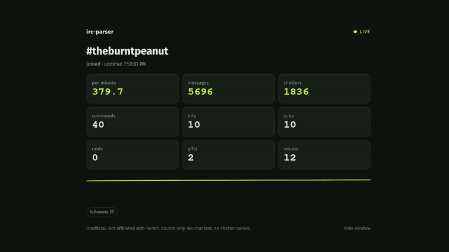

# irc-parser

A Self-hosted, read-only Twitch chat analytics API. A single C++ process connects to Twitch IRC over TLS, keeps a short in-memory window, and serves it as JSON.

This is not a Twitch product. Read [COMPLIANCE.md](COMPLIANCE.md) as twitch guidelines are subject to change.

## Demo



Open [http://127.0.0.1:8080/demo](http://127.0.0.1:8080/demo) while the process is running. The GIF above is the recording. GitHub serves that file from the repo. You do not need Cloudflare for it.

## What it is

```
Twitch IRC (TLS 6697)
        |
        v
  irc-parser          GET /v1/channels/<name>/analytics
  (this binary)  ---> JSON counts for the operator
        ^
        |
  POST /v1/channels   channels you explicitly watch
```

Follows object oriented model for re-usable classes/services:

| Class | Job |
| --- | --- |
| `TlsSession` | One verified TLS connection. Host is fixed. |
| `IrcParser` | IRCv3 tags and RFC1459 lines. |
| `TwitchClient` | Auth, PING/PONG, paced JOIN/PART, reconnect. Read-only. |
| `AnalyticsStore` | Rolling window of counts. No message text. |
| `HttpServer` | Local JSON API. API key required. |
| `App` | Wires the four together. |

## Run with Docker

```bash
cp .env.example .env
# set IRCP_API_KEY, TWITCH_NICK, TWITCH_OAUTH_TOKEN, IRCP_CHANNELS
docker compose up --build -d
curl -s http://127.0.0.1:8080/health
```
Create a twitch application, store client id, and client secret, to get chat:read only artifact. 

Compose binds the published port to `127.0.0.1`.

Token: a user access token for an account you own, scope `chat:read` only. `TWITCH_NICK` is that account's login. Official flow: [Twitch authentication](https://dev.twitch.tv/docs/authentication/).

## Run the binary

Needs CMake, a C++17 compiler, and OpenSSL.

```bash
cmake -S . -B build -DCMAKE_BUILD_TYPE=Release
cmake --build build
./build/ircp-tests
set -a && source .env && set +a
./build/irc-parser
```

Default bind is `127.0.0.1:8080`.


## API

`/health` is open and returns `{"status":"ok"}`. Everything else needs `Authorization: Bearer <IRCP_API_KEY>` or `X-API-Key`.

| Method | Path | |
| --- | --- | --- |
| `GET` | `/v1/status` | Connection, nick, scopes, compliance flags. No token. |
| `GET` | `/v1/channels` | Watched channels, summary counts. |
| `POST` | `/v1/channels` | `{"channel":"name"}` or a `https://twitch.tv/name` URL. |
| `DELETE` | `/v1/channels/<name>` | Stop watching. |
| `GET` | `/v1/channels/<name>/analytics` | Windowed counts. |

```bash
curl -s -H "Authorization: Bearer $IRCP_API_KEY" \
  http://127.0.0.1:8080/v1/channels/yourchannel/analytics
```

Analytics are counts: messages per minute, unique chatters, bits, subs, raids, timeouts, top command names, top emote ids. Message text is not stored and is not in the JSON. A deleted or cleared message is dropped from the window.

`IRCP_WINDOW_SECONDS` is 60 to 86400 (default 900). `IRCP_MAX_CHANNELS` is 1 to 100 (default 20).

## Environment

See `.env.example`.

## Build notes

Boost, spdlog, and the old stdout pipe were removed. The previous socket read/send path was commented out, so the binary connected and exited. `nlohmann/json` stays as the one vendored header.

## Updates Nov. 20th 2026:
- [x] Simplified api binary, removed Boost and replaced with c++ native networking sockets.
- [x] Removed spdlog for logger class and signal interrupts
- [x] Keep Json SIMD process for processing output to json
- [x] Added Docker containers and compose 

## Future Upgrades:
- [] Compliance Updates: SQlite log meta-data, follows twitch guidelines removes memory on CLEAR MESSAGE server commands
